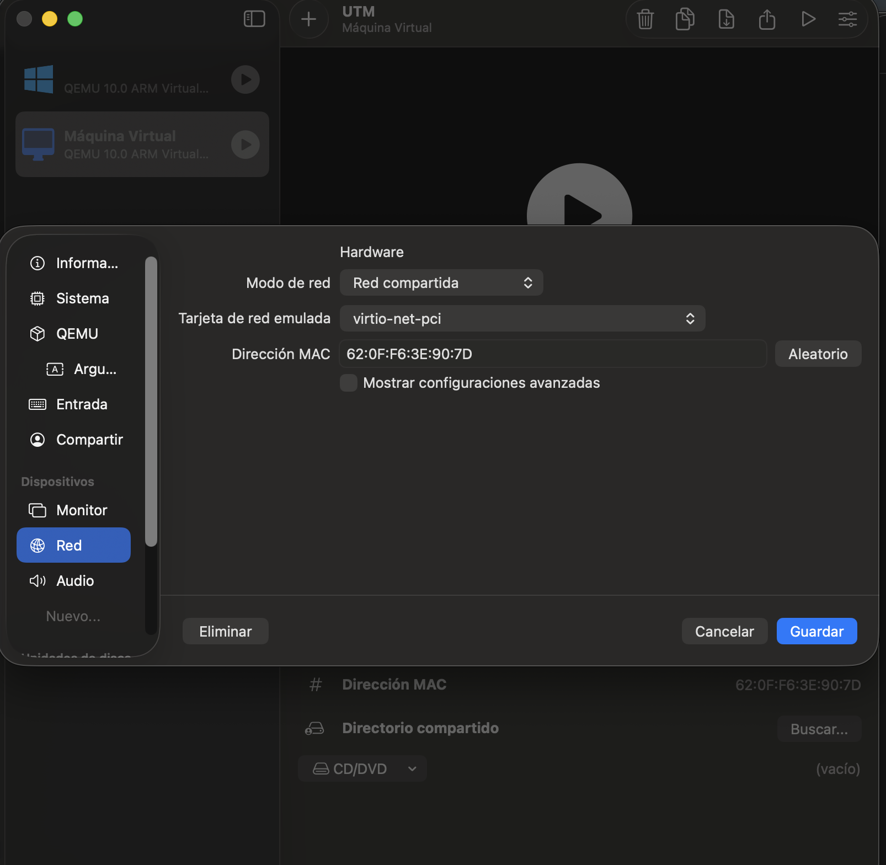
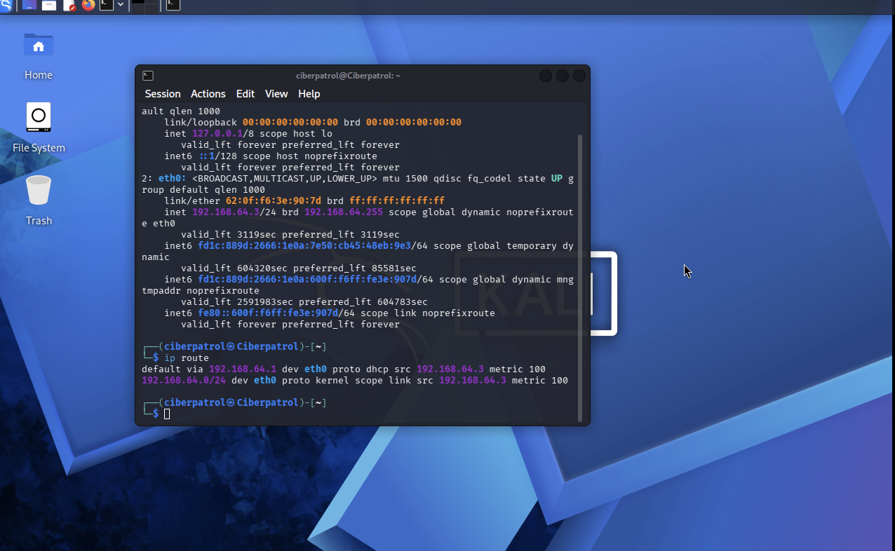
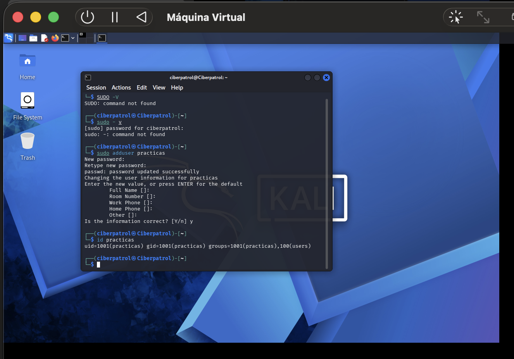
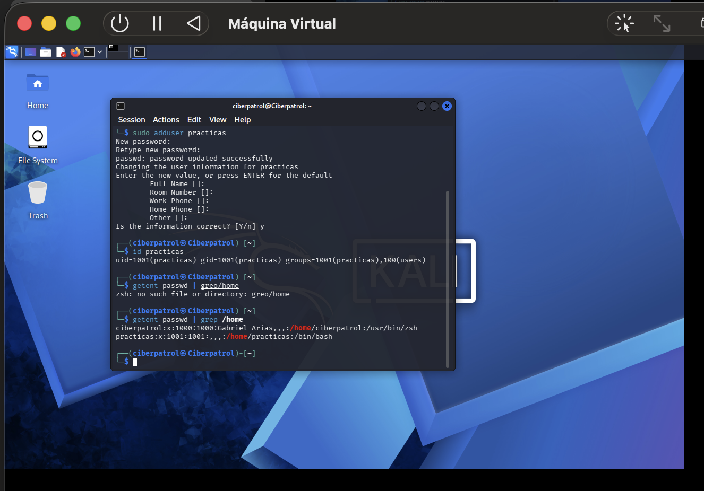
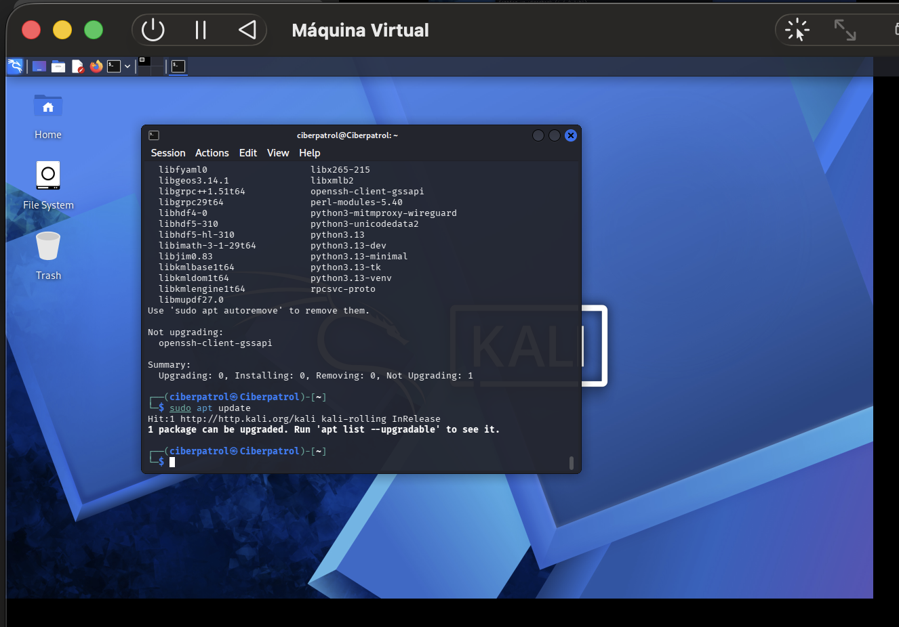
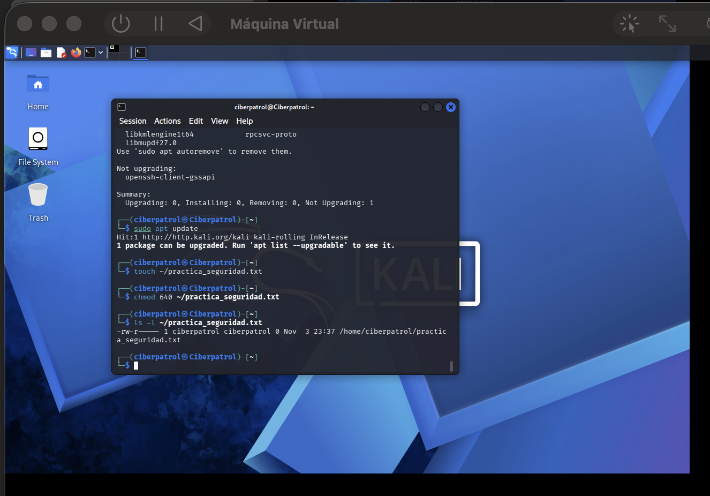
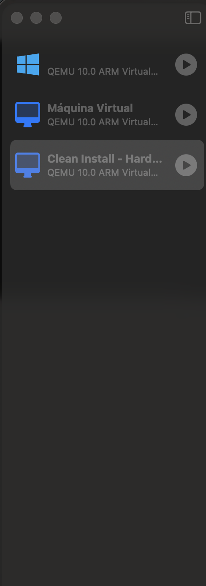

# Laboratorio seguro de ciberseguridad

Reporte técnico de configuración de un entorno virtualizado para prácticas de ciberseguridad: aislamiento de red, hardening básico y punto de restauración.

**Autor:** Félix Gabriel Oscar Arias
**Fecha:** 3 de noviembre de 2026

---

## Entorno y alcance

Se construyó una máquina virtual aislada destinada a prácticas de ciberseguridad, aplicando hardening básico antes de su primer uso y conservando un punto de restauración.

El equipo anfitrión (host) es una MacBook con procesador Apple Silicon. Por esa arquitectura, VirtualBox no resulta funcional: su versión para ARM es preliminar y no ejecuta imágenes x86. En consecuencia se utilizó **UTM**, hipervisor basado en QEMU, con **Kali Linux** como sistema operativo invitado.

La equivalencia entre ambas herramientas es directa:

| Concepto de la consigna | Implementación en UTM |
| --- | --- |
| VirtualBox | UTM (QEMU) |
| Red en modo NAT | Modo Red compartida |
| Usuario Estándar de Windows | Usuario sin privilegios de sudo en Linux |
| Windows Update | `apt update` / `apt full-upgrade` |
| Snapshot de VirtualBox | Clon completo de la máquina virtual |

Todos los controles exigidos se cumplieron en su equivalente funcional, sin omitir ninguno.

---

## 1. La fundación: virtualización y red aislada

La red de la máquina virtual se configuró en modo **Red compartida**, equivalente al NAT de VirtualBox, antes del primer arranque del sistema operativo.

**Por qué se eligió este modo.** En modo NAT la máquina virtual queda detrás de una traducción de direcciones que administra el host. Puede iniciar conexiones hacia afuera —necesarias para descargar actualizaciones y paquetes— pero ningún equipo de la red local puede iniciar una conexión hacia ella. El tráfico entrante no solicitado no tiene ruta de llegada.

**Cómo protege al host.** El laboratorio está destinado a manipular herramientas de prueba y, eventualmente, muestras de software malicioso. Si la máquina virtual fuera comprometida, el modo NAT impide que actúe como punto de pivote hacia el resto de la red doméstica: no ve a los demás dispositivos como vecinos de capa 2 ni puede escanearlos directamente.

**Por qué se descartó el modo Bridge.** En modo puente la máquina virtual recibe una dirección IP del router y se comporta como un equipo más de la red, visible y alcanzable por cualquier otro dispositivo. Eso anula el aislamiento y convierte al laboratorio en una superficie de ataque dentro de la red propia.

### Evidencia

*Captura 1.1 — Configuración de red de la máquina virtual en UTM.*



*Captura 1.2 — Verificación del direccionamiento desde el sistema invitado.*



La interfaz `eth0` recibió por DHCP la dirección `192.168.64.3/24`, con puerta de enlace predeterminada en `192.168.64.1`. Ese rango corresponde a la red privada que genera el propio hipervisor, no al router de la red local. Esto confirma que el aislamiento está efectivamente aplicado y no únicamente declarado en la configuración.

---

## 2. Usuarios y actualizaciones

Se creó un usuario de trabajo sin privilegios administrativos, separado de la cuenta con capacidad de elevación, y se dejó el sistema al día.

**Principio de mínimo privilegio.** Un usuario debe contar únicamente con los permisos que su tarea requiere. Si las prácticas se realizan desde una cuenta administrativa, cualquier proceso que se ejecute —incluido uno malicioso— hereda esos privilegios y puede modificar el sistema completo. Desde una cuenta limitada, el daño potencial queda contenido al ámbito de ese usuario.

**Elevación explícita.** El uso de `sudo` obliga a declarar cada acción privilegiada de forma puntual y deja constancia en los registros del sistema. La elevación deja de ser el estado permanente y pasa a ser una excepción trazable.

**Por qué actualizar antes de empezar.** Un sistema sin parches arrastra vulnerabilidades públicas y documentadas. Partir de una instalación al día garantiza que cualquier debilidad que se estudie más adelante sea una introducida de forma deliberada, no un resto de la instalación inicial.

### Comandos ejecutados

```bash
sudo adduser practicas
id practicas
getent passwd | grep /home
sudo apt update && sudo apt full-upgrade -y
```

### Evidencia

*Captura 2.1 — Creación del usuario y verificación de sus grupos.*



La salida muestra `uid=1001(practicas)`, `gid=1001(practicas)` y los grupos `practicas` y `users`. No incluye el grupo `sudo`, lo que acredita que la cuenta carece de capacidad de elevación.

*Captura 2.2 — Usuarios del sistema con directorio propio.*



Conviven dos cuentas: `ciberpatrol` (uid 1000), la cuenta administrativa, y `practicas` (uid 1001), la cuenta de trabajo sin privilegios.

*Captura 2.3 — Resultado de la actualización del sistema.*



La distribución utilizada es Kali Linux, de tipo *rolling release*. Por esa razón no alcanza con `apt upgrade`, que omite los paquetes cuya actualización implica instalar o remover otros: fue necesario ejecutar `apt full-upgrade`.

Queda un único paquete retenido, `openssh-client-gssapi`, que el gestor informa como *Not Upgrading*. Es una situación transitoria habitual en distribuciones rolling, cuando un paquete está entre versiones y sus dependencias todavía no se publicaron. No se forzó su instalación: forzar un paquete por encima del criterio del gestor de dependencias introduce más riesgo que el que resuelve.

---

## 3. Permisos y gestión desde la terminal

Se creó un archivo de prueba, se le asignaron permisos restrictivos y se verificó el resultado.

### Comandos ejecutados

```bash
touch ~/practica_seguridad.txt
chmod 640 ~/practica_seguridad.txt
ls -l ~/practica_seguridad.txt
```

**Cómo se leen los permisos.** La salida `-rw-r-----` se divide en cuatro partes. El primer carácter indica el tipo de archivo. Los tres bloques siguientes, de tres caracteres cada uno, corresponden al dueño, al grupo y al resto de los usuarios.

| Bloque | Valor | Significado |
| --- | --- | --- |
| Dueño | `rw-` | Lee y escribe, no ejecuta |
| Grupo | `r--` | Solo lectura |
| Otros | `---` | Sin acceso |

**Por qué importa.** Los permisos del sistema de archivos son el control de acceso más básico de un sistema Unix. Un archivo con permisos excesivos puede exponer credenciales, claves o configuraciones, o permitir que un proceso sin privilegios altere algo que no debería.

### Evidencia

*Captura 3.1 — Permisos del archivo creado.*



La salida muestra `-rw-r-----`, con `ciberpatrol` como dueño y grupo. El archivo no es legible por el resto de los usuarios del sistema, entre ellos `practicas`.

La ejecución de `apt update` y `apt full-upgrade` desde la terminal está documentada en la captura 2.3.

---

## 4. La red de seguridad: punto de restauración

Con la máquina apagada y el hardening ya aplicado, se creó un punto de restauración denominado **Clean Install - Hardening applied**.

**Procedimiento.** UTM no ofrece una función de instantáneas en su interfaz, a diferencia de VirtualBox: es una de las características más solicitadas por sus usuarios y aún no está implementada. El punto de restauración se materializó entonces mediante un clon completo de la máquina virtual, creado con la función Clonar del propio UTM.

Funcionalmente cumple el mismo propósito: conserva el estado completo del sistema en un momento determinado y permite volver a él descartando la máquina en uso. La diferencia respecto de una instantánea es el costo en disco, ya que el clon duplica la imagen en lugar de registrar solo las diferencias.

**Por qué el punto de restauración va después del hardening y antes de las prácticas.** Debe reflejar el estado limpio y ya asegurado del sistema. Tomarlo antes del hardening obligaría a repetir toda la configuración en cada restauración; tomarlo después de las primeras prácticas arrastraría cambios de origen incierto.

**Función en el laboratorio.** El análisis de software malicioso y la ejecución de herramientas ofensivas alteran el sistema de formas que no siempre son visibles ni reversibles. Sin un punto de restauración, la única salida ante un entorno contaminado es reinstalar desde cero. Con él, el estado limpio se recupera en minutos y se garantiza que cada prueba parta de una línea base idéntica, condición necesaria para que los resultados sean comparables entre sí.

### Evidencia

*Captura 4.1 — Punto de restauración en la biblioteca de UTM.*



El clon se creó con la máquina apagada y después de aplicar las tres capas de hardening documentadas.

---

## Errores evitados

**No trabajar de forma permanente como root o administrador.** Resulta más cómodo, y por eso es habitual, pero elimina la única barrera que separa un error o un proceso hostil del control total del sistema. Se creó un usuario sin privilegios y la elevación se realiza mediante `sudo`, de manera puntual y registrada.

**No configurar la red en modo puente.** Habría expuesto la máquina virtual como un equipo más de la red doméstica, alcanzable por cualquier otro dispositivo. En un entorno destinado a descargar y ejecutar herramientas de prueba, eso traslada el riesgo del laboratorio a la red real.

---

## Conclusión

El laboratorio quedó operativo con los cuatro controles exigidos: red aislada, usuario sin privilegios, sistema actualizado con permisos verificados, y punto de restauración registrado.

El criterio que ordena las cuatro medidas es el mismo: limitar el alcance de un eventual compromiso y poder volver a un estado conocido. El aislamiento acota hasta dónde llega un incidente; el mínimo privilegio acota qué puede hacer; la actualización reduce las vías de entrada; y el punto de restauración garantiza la recuperación. Son los mismos principios que rigen el aseguramiento de un sistema en producción, aplicados a escala de un entorno de práctica.
